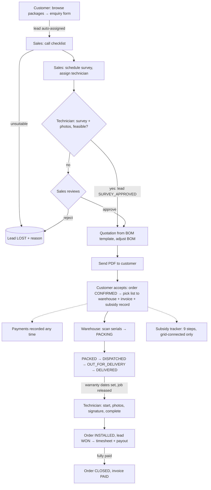

# RoofRay Solutions: Rooftop Solar Operations ERP

End-to-end operations for a rooftop-solar installer: customer enquiry → sales → site survey → quotation → payment →
order → warehouse fulfilment with serial tracking → installation → invoicing → government subsidy tracking, with
live dashboards. FastAPI + PostgreSQL + Redis + React (Vite). Firebase Authentication in production.

There is **no demo data**. A fresh install contains one admin and the configuration catalogue; everything else is
created by real people using the app. `scripts/check_no_mock_data.sh` enforces this.

---

## Setup

### Docker (Postgres + Redis + backend + frontend)

```bash
docker compose up -d --build            # runs `alembic upgrade head` on start; seeds nothing
docker compose exec backend python -m app.bootstrap_admin --email you@company.com --name "Your Name"
docker compose exec backend python -m app.load_catalog   # configuration only (see below)
```

Frontend: http://localhost:5173 · API docs: http://localhost:8000/docs

### Local development

```bash
cd backend
python -m venv venv && source venv/bin/activate
pip install -r requirements.txt
alembic upgrade head
python -m app.bootstrap_admin --email you@company.com --name "Your Name"   # prompts for a password in local auth mode
python -m app.load_catalog
uvicorn app.main:app --reload --port 8000

cd ../frontend && npm install && npm run dev     # http://localhost:5173 (proxies /api to :8000)
```

### Commands

| Command | What it does |
|---|---|
| `python -m app.bootstrap_admin --email … --name …` | Creates the **first admin** (Firebase user + DB row). Nothing else. |
| `python -m app.load_catalog` | Loads **configuration**: product catalogue (stock starts at 0), On-Grid and Off-Grid BOM templates for 1–5 kW, per-product warranty terms, PM Surya Ghar scheme content and amounts. Insert-only: never overwrites admin edits. Never runs automatically. |
| `python -m app.reset_db --yes` | **Dev only.** Deletes all transactional data; keeps users, linked customer profiles and configuration; resets stock to 0. Refuses when `ENV=production`. |
| `scripts/check_no_mock_data.sh` | Fails if mock libraries, demo markers, demo logins, seed scripts, hard-coded emails/phones/amounts or pre-filled sample values appear outside tests. |

Opening stock is recorded through **Inventory → Purchases** (it appears as money spent on the dashboard).

### Authentication

* **Firebase mode** (production): place the service-account JSON at `FIREBASE_CREDENTIALS_PATH` and set
  `FIREBASE_WEB_API_KEY`, `FIREBASE_WEB_AUTH_DOMAIN`, `FIREBASE_WEB_PROJECT_ID`, `FIREBASE_WEB_APP_ID`.
  The frontend signs in with Firebase and sends ID tokens; staff receive Firebase's password-reset email on creation.
* **Local mode** (automatic when no Firebase credentials are present): PBKDF2 password hashes and signed
  12-hour session tokens (`SECRET_KEY`). New staff get a one-time password setup link (shown to the admin).
  No email server is wired: forgot-password links are printed to the server log.

`GET /api/auth/config` tells the frontend which mode is active. Public self-registration always creates a
**customer**; only an admin can create staff (Users screen: name, email, role, technician hourly rate, active flag).

---

## Roles

| Capability | Customer | Sales | Technician | Warehouse | Admin |
|---|:-:|:-:|:-:|:-:|:-:|
| Home after login | `/customer` | `/sales` | `/technician` | `/warehouse` | `/admin` |
| Packages, enquiry, tracker, quotes, invoices, serials & warranty, tickets, schemes, subsidy | own | – | – | – | all |
| Leads, call checklist, mark LOST | – | **own leads** | – | – | all |
| Schedule survey + assign technician (calendar view) | – | own leads | – | – | ✓ |
| Submit survey (measurements, shade, photos) | – | – | **assigned** | – | ✓ |
| Approve / reject survey | – | own leads | – | – | ✓ |
| Quotation (BOM edit, send), record acceptance & payment, confirm order | – | own leads | – | – | ✓ |
| Pick lists, serial scanning, fulfilment stages, stock purchases | – | view | – | **fulfilment-stage orders** | ✓ |
| Installation jobs (start, photos, signature, complete) | – | view | **assigned, after delivery** | – | ✓ |
| Tickets | own | ✓ | assigned | – | ✓ |
| Users, schemes, finance dashboard, expenses, payouts, exports | – | – | – | – | ✓ |

Every endpoint uses `require_role(...)` plus the object-level rules in `backend/app/core/access.py`. Every route in
the frontend is wrapped in `RoleRouteGuard`.

---

## Workflow (strict state machine, enforced in the service layer)



**Gates** (HTTP 400 when violated):

1. A quotation cannot be created before the survey is **APPROVED**. The technician approves it on submission by confirming feasibility; otherwise sales reviews it.
2. A quotation can only be accepted after it was **sent**; one order per lead.
3. Accepting a quote confirms the order and sends its pick list to the warehouse; other open quotes for that enquiry are rejected.
4. Serials are scanned while packing; duplicates and serials already assigned to another order are rejected (Redis lock + unique `serial_no`).
5. **PACKED** and **DELIVERED** require every serialised BOM item to be scanned; stages cannot be skipped.
6. Warranty start = delivery date, end = start + product warranty years. Never typed.
7. The install job is invisible to the technician until the order is **DELIVERED**; completion needs a started job, ≥1 photo and the customer's signature.
8. The subsidy tracker only advances one step at a time (Not applied → Eligibility checked → Registered → Feasibility approval → Installation done → Inspection & commissioning → Claim submitted → Approved → Disbursed); Off-Grid orders are not eligible.

Every hand-off writes an **audit log** entry, a **notification** for the receiving users and a row in the
**transactional outbox**, in the same DB transaction.

### Live updates

* `GET /api/events?token=…` is a Server-Sent Events stream that reads the outbox, filtered to the user's role/own records
  (admin sees all). Works across workers because it reads the database.
* All screens subscribe through `frontend/src/live/LiveEvents.tsx` (`useLiveRefresh`) and refetch on relevant events;
  the navbar bell shows notifications live.
* Dashboard aggregates are computed from the database and cached in Redis for 45 s; any commit that emitted an
  event invalidates the cache. Without Redis the API simply queries the DB every time.

---

## Tests and checks

```bash
cd backend && pytest                      # 35 tests, throwaway SQLite DB (never touches your data)
scripts/check_no_mock_data.sh
cd frontend && npm run build
```

`tests/test_full_flow_empty_db.py` walks the whole chain on a brand-new empty database with accounts created through
the API, and checks that dashboards show zeros before and real values after. To run the same chain over HTTP
against a live server (e.g. a fresh Postgres after `alembic upgrade head`, `bootstrap_admin --email owner@example.com
--password owner-password` and `load_catalog`):

```bash
E2E_BASE_URL=http://localhost:8000 pytest tests/test_full_flow_empty_db.py
```

---

## Repository structure

```
backend/
  app/
    core/        config, database, security (Firebase/local auth), access rules, events (outbox), cache, uploads
    models/      SQLAlchemy models (incl. outbox_events, expenses, survey_photos, subsidy_events)
    routers/     API endpoints (auth, users, leads, surveys, quotes, orders, inventory, dispatch, jobs,
                 tickets, finance, reports, customer, events, notifications)
    services/    workflow logic and gates
    bootstrap_admin.py · load_catalog.py · reset_db.py
  alembic/       migrations (baseline from models)
  tests/         pytest suite + helpers
frontend/src/
  api/client.ts            fetch wrapper + authenticated downloads
  context/AuthContext.tsx  Firebase / local sign-in
  live/LiveEvents.tsx      SSE provider + useLiveRefresh
  pages/                   role workspaces
scripts/check_no_mock_data.sh
```
